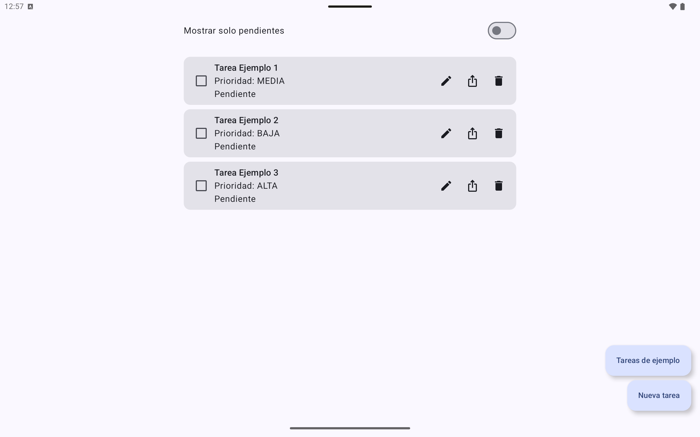
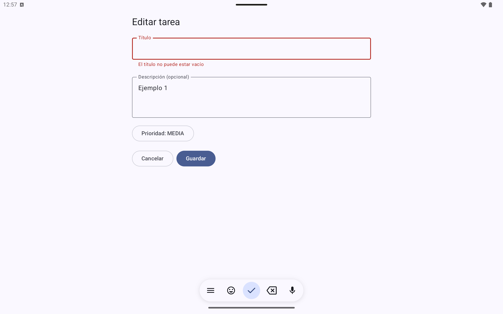
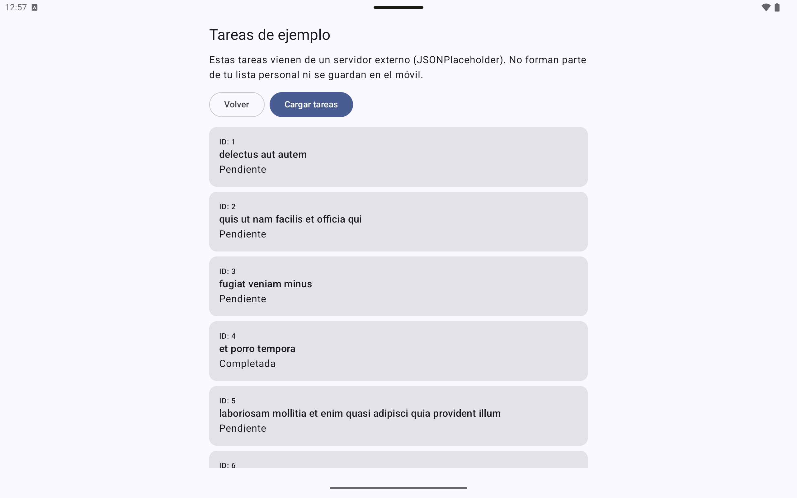
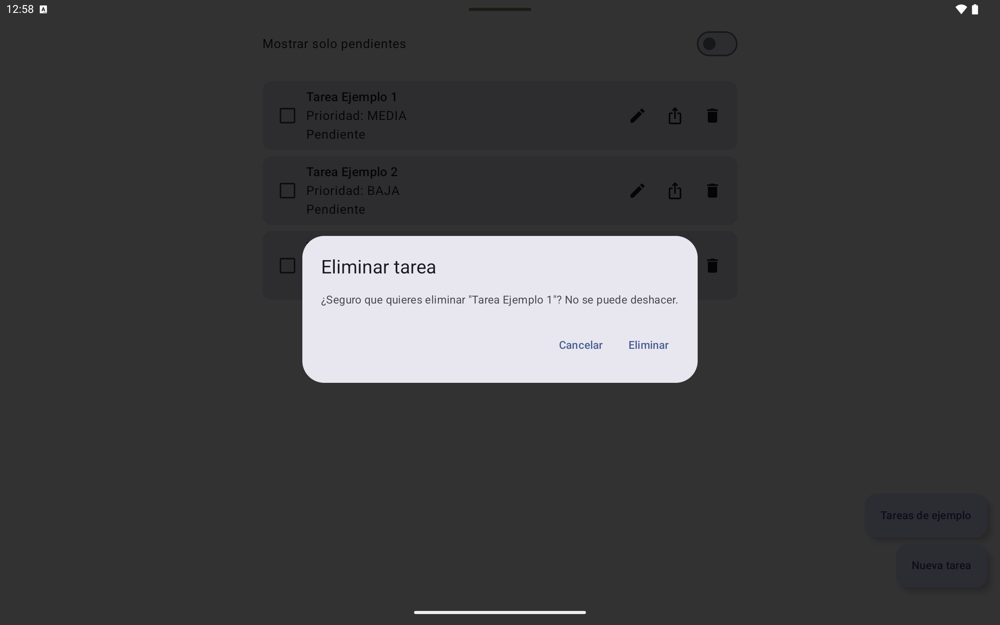

# Gestor Personal de Tareas

Aplicación Android para organizar tareas personales, académicas o profesionales. Permite registrar, consultar, modificar, completar, eliminar y compartir tareas, conserva la información entre ejecuciones y consulta tareas de ejemplo en un servicio web.

Práctica del módulo **Programación Multimedia y Dispositivos Móviles (PMDM)**, desarrollada con Kotlin, Android Studio y Jetpack Compose.

## Funcionalidades implementadas

- **Listado de tareas** en una lista desplazable (`LazyColumn`) con título, prioridad y estado. Si no hay tareas, se muestra un mensaje informativo.
- **Creación de tareas** con título, descripción y prioridad (menú desplegable). Validaciones: el título no puede estar vacío ni tener menos de tres caracteres tras eliminar los espacios exteriores. Los errores se muestran junto al campo. El botón Guardar se deshabilita tras pulsarlo para evitar duplicados.
- **Edición** de título, descripción y prioridad, reutilizando el formulario de creación.
- **Marcar como completada** mediante un `Checkbox`.
- **Eliminación con confirmación** mediante un `AlertDialog`. Si se cancela, la tarea no cambia.
- **Almacenamiento permanente con Room**: las tareas se conservan al cerrar y reabrir la aplicación.
- **Filtro «Mostrar solo pendientes»** (`Switch`) guardado con Preferences DataStore. El valor inicial es mostrar todas las tareas.
- **Tareas de ejemplo**: consulta a `GET /todos?userId=1` de JSONPlaceholder mediante Retrofit, con indicador de carga, botón deshabilitado durante la petición, mensaje de error y botón de reintento. Estas tareas no se guardan en Room y se muestran en una pantalla aparte.
- **Compartir una tarea** mediante un Intent implícito `ACTION_SEND` (título, descripción y prioridad), controlando que no exista ninguna aplicación compatible. No se muestra ningún mensaje de envío realizado.
- **Adaptación a distintos tamaños de pantalla**: el contenido se limita a un ancho máximo y se centra en pantallas grandes.

## Organización del proyecto

Una única `MainActivity`, con navegación sencilla basada en estados (`LISTA`, `FORMULARIO`, `EJEMPLO`).

- `model`: clases `Tarea` y `Prioridad`.
- `ui`: pantallas y componentes Compose (`ListaTareasScreen`, `FormularioTareaScreen`, `TareasEjemploScreen`, `CompartirTarea`) y el tema.
- `data`: entidad (`TareaEntity`), DAO (`TareaDao`), base de datos (`AppDatabase`) y repositorios (`TareaRepository`, `PreferenciasRepository` para DataStore).
- `network`: cliente Retrofit (`JsonPlaceholderApi`), modelo remoto (`TareaRemota`) y estados de la consulta (`TareasRemotasRepository`).

## Bibliotecas utilizadas

| Biblioteca | Versión | Para qué se usa |
|---|---|---|
| Jetpack Compose (BOM) con Material 3 | 2026.02.01 | Interfaz |
| Room (con KSP) | 2.8.5 / 2.3.13 | Base de datos local; KSP genera el código de Room al compilar |
| DataStore Preferences | 1.2.1 | Preferencia «Mostrar solo pendientes» |
| Retrofit y convertidor Gson | 3.0.0 | Petición HTTP y conversión del JSON a objetos Kotlin |
| Corrutinas y Flow | incluidas como dependencia de Room y DataStore | Operaciones asíncronas y datos reactivos |

Entorno: Android Studio Rabbit 2 (2026.2.2), Android Gradle Plugin 9.5.1, Kotlin 2.2.10, minSdk 24.

## Instrucciones para ejecutar la aplicación

1. Clonar el repositorio: `git clone https://github.com/AntonioMH1501/GestorTareas.git`
2. Abrir la carpeta del proyecto en Android Studio y esperar a que termine la sincronización de Gradle (requiere conexión a Internet).
3. Seleccionar un emulador o dispositivo y pulsar **Run**.
4. Alternativa: instalar el APK de depuración incluido en `entrega/GestorTareas-debug.apk`.

## Emuladores utilizados

| | Emulador 1 (pantalla compacta) | Emulador 2 (pantalla grande) |
|---|---|---|
| Dispositivo | Pixel 6 | Pixel Tablet |
| Versión de Android | 17.0 (API 37.0) | 16.0 (API 36.0) |
| Arquitectura | x86_64 | x86_64 |

## Pruebas realizadas

Todas las pruebas se han realizado manualmente en los dos emuladores.

| Nº | Prueba | Resultado esperado | Emulador 1 | Emulador 2 |
|---|---|---|---|---|
| 1 | Crear una tarea válida | Se guarda y aparece en la lista | OK | OK |
| 2 | Intentar guardar un título vacío (y solo espacios) | Se muestra un error y no se crea la tarea | OK | OK |
| 3 | Editar una tarea | Los cambios se muestran correctamente | OK | OK |
| 4 | Marcar una tarea como completada | Su estado cambia y queda guardado | OK | OK |
| 5 | Cancelar una eliminación | La tarea no desaparece | OK | OK |
| 6 | Eliminar una tarea confirmando | La tarea desaparece de la base de datos | OK | OK |
| 7 | Cerrar y volver a abrir la aplicación | Se recuperan las tareas guardadas | OK | OK |
| 8 | Activar el filtro y reiniciar | Se conserva la preferencia seleccionada | OK | OK |
| 9 | Consultar la API con Internet | Se muestran las tareas recibidas | OK | OK |
| 10 | Consultar la API sin conexión (modo avión) | Se muestra un error y se permite reintentar | OK | OK |
| 11 | Compartir una tarea | Se abre el selector de aplicaciones compatibles | OK | OK |
| 12 | Cambiar la orientación del dispositivo | La aplicación sigue funcionando y conserva sus datos persistidos | OK | OK |

## Capturas de pantalla

**Listado principal de tareas**

**Formulario de creación con error de validación**

**Tareas de ejemplo obtenidas de la API**

**Confirmación antes de eliminar una tarea**

## Uso de IA

Durante el desarrollo se ha utilizado un chat de IA para recibir explicaciones de cada apartado, resolver errores y organizar las fases del trabajo.

Enlace al chat: https://claude.ai/share/0adbb8b4-0585-4144-850e-ccb5d5268652

## Incidencias conocidas

- El resultado de la consulta a «Tareas de ejemplo» no se conserva al girar el dispositivo, porque su estado no se guarda en un `ViewModel`. Hay que volver a pulsar «Cargar tareas».
- Al arrancar la aplicación puede mostrarse un instante el mensaje de lista vacía, o la lista completa con el filtro activo, hasta que Room y DataStore entregan sus primeros datos.
- Las pantallas se resuelven con un estado de navegación sencillo en `MainActivity`, sin biblioteca de navegación, como permite el enunciado.
- Solo se ha probado la variante de depuración (debug), no la variante release.
- No hay funcionalidades obligatorias sin completar.